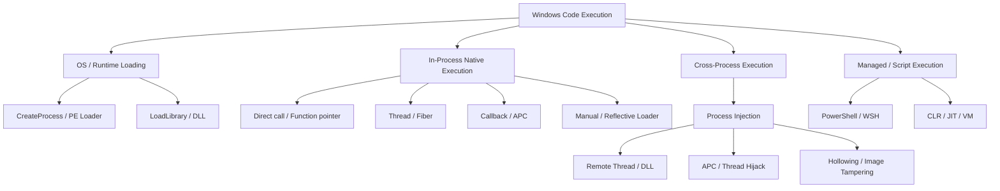

# Các phương pháp Shellcode / Code Execution trên Windows
## Mục lục

1. [Nền tảng: shellcode và code execution là gì?](#1-nền-tảng-shellcode-và-code-execution-là-gì)
   - [1.1. Code execution](#11-code-execution)
   - [1.2. Shellcode](#12-shellcode)
   - [1.3. Shellcode không phải PE](#13-shellcode-không-phải-pe)
2. [Phân loại theo ba câu hỏi cốt lõi](#2-phân-loại-theo-ba-câu-hỏi-cốt-lõi)
   - [Bảng nhìn nhanh](#bảng-nhìn-nhanh)
3. [Chạy chương trình PE theo cơ chế chuẩn](#3-chạy-chương-trình-pe-theo-cơ-chế-chuẩn)
   - [3.1. Nguyên lý](#31-nguyên-lý)
   - [3.2. Tạo process con có kiểm soát](#32-tạo-process-con-có-kiểm-soát)
4. [Local shellcode execution](#4-local-shellcode-execution)
   - [4.1. Cơ chế](#41-cơ-chế)
   - [4.2. Chạy đúng sáu byte trả về 42](#42-chạy-đúng-sáu-byte-trả-về-42)
   - [4.3. Trường hợp hay nhầm: function pointer](#43-trường-hợp-hay-nhầm-function-pointer)
5. [Thread / fiber execution](#5-thread--fiber-execution)
   - [5.1. Thread execution](#51-thread-execution)
   - [5.2. Fiber execution](#52-fiber-execution)
6. [Callback-based execution](#6-callback-based-execution)
   - [6.1. Callback là gì?](#61-callback-là-gì)
   - [6.2. EnumWindows](#62-enumwindows)
7. [APC-based execution](#7-apc-based-execution)
   - [7.1. APC là gì?](#71-apc-là-gì)
   - [7.2. APC trong cùng process](#72-apc-trong-cùng-process)
8. [DLL / module execution](#8-dll--module-execution)
   - [8.1. Hai phương thức liên kết DLL](#81-hai-phương-thức-liên-kết-dll)
   - [8.2. Resolve export động](#82-resolve-export-động)
   - [8.3. DLL Entry Point, TLS callback](#83-dll-entry-point-tls-callback)
9. [Manual / reflective PE loading](#9-manual--reflective-pe-loading)
   - [9.1. Tại sao PE không giống raw shellcode?](#91-tại-sao-pe-không-giống-raw-shellcode)
   - [9.2. Manual Mapping](#92-manual-mapping)
   - [9.3. Reflective DLL Loading](#93-reflective-dll-loading)
   - [9.4. PE-to-Shellcode](#94-pe-to-shellcode)
10. [Process Injection](#10-process-injection)
   - [10.1. Định nghĩa chính xác](#101-định-nghĩa-chính-xác)
   - [10.2. Các nhánh kỹ thuật nghiên cứu](#102-các-nhánh-kỹ-thuật-nghiên-cứu)
   - [10.3. Các API hay gặp - cần hiểu vai trò, không học thuộc chuỗi API](#103-các-api-hay-gặp---cần-hiểu-vai-trò-không-học-thuộc-chuỗi-api)
   - [10.4. Một ví dụ phân tích bằng mô hình thay vì payload injection](#104-một-ví-dụ-phân-tích-bằng-mô-hình-thay-vì-payload-injection)
   - [10.5. Tại sao phần này không giống các lab local?](#105-tại-sao-phần-này-không-giống-các-lab-local)
11. [Script, managed runtime và JIT](#11-script-managed-runtime-và-jit)
   - [11.1. Scripting](#111-scripting)
   - [11.2. Managed runtime](#112-managed-runtime)
   - [11.3. JIT-generated code](#113-jit-generated-code)
12. [Các trục phân loại dễ bị nhầm lẫn](#12-các-trục-phân-loại-dễ-bị-nhầm-lẫn)
   - [12.1. Payload type ≠ execution trigger ≠ target process](#121-payload-type--execution-trigger--target-process)
   - [12.2. “Execution” không đồng nghĩa “Injection”](#122-execution-không-đồng-nghĩa-injection)
   - [12.3. Local, remote, cross-process](#123-local-remote-cross-process)
   - [12.4. Có phải ROP/JOP cũng là execution?](#124-có-phải-ropjop-cũng-là-execution)
13. [Góc nhìn Windows Internals và phòng thủ](#13-góc-nhìn-windows-internals-và-phòng-thủ)
   - [13.1. Các đối tượng cần nắm](#131-các-đối-tượng-cần-nắm)
   - [13.2. Memory type và protection - cần phân biệt](#132-memory-type-và-protection---cần-phân-biệt)
   - [13.3. Vì sao DEP/CFG không phải cơ chế nhận diện malware?](#133-vì-sao-depcfg-không-phải-cơ-chế-nhận-diện-malware)
   - [13.4. Công cụ quan sát nên dùng](#134-công-cụ-quan-sát-nên-dùng)
   - [13.5. Một bảng điều tra mẫu](#135-một-bảng-điều-tra-mẫu)
14. [Tài liệu tham khảo](#14-tài-liệu-tham-khảo)
   - [Microsoft Learn (tài liệu gốc WinAPI)](#microsoft-learn-tài-liệu-gốc-winapi)
   - [MITRE ATT&CK](#mitre-attck)
   - [Source code / Assembly](#source-code--assembly)

---

## 1. Nền tảng: shellcode và code execution là gì?

### 1.1. Code execution

**Code execution** là việc CPU thực thi các instruction tại một địa chỉ cụ thể trong **ngữ cảnh thực thi** (process, thread, privilege level, register state, stack...). Nó không đồng nghĩa với khai thác lỗ hổng hay thực thi mã độc.

Ví dụ:

```c
int add(int x, int y)
{
    return x + y;
}

int main(void) {
    return add(2, 3);
}
```

CPU chuyển quyền điều khiển tới `add()` thông qua instruction `call`, sau đó quay lại với `ret`. Đây cũng là code execution, nhưng **không phải shellcode execution** và **không phải process injection**.

### 1.2. Shellcode

**Shellcode** là một đoạn mã máy được thiết kế để chạy từ một vị trí/bối cảnh thực thi nhất định, thường không phụ thuộc vào cấu trúc PE loader thông thường. Tên “shellcode” có nguồn gốc lịch sử từ payload mở shell, nhưng shellcode hiện đại **không bắt buộc phải mở shell**.

Ba điểm quan trọng:

- **Machine code**: dãy byte mà CPU giải mã thành instruction; ví dụ `B8 2A 00 00 00 C3` trên x86-64.
- **Position-independent code (PIC)**: mã được viết để hạn chế phụ thuộc vào địa chỉ nạp cố định. Không phải mọi blob mã máy đều là PIC đúng nghĩa.
- **Execution context**: mã cần phù hợp kiến trúc CPU, calling convention, stack, quyền bộ nhớ, địa chỉ API/dữ liệu...

**Ví dụ shellcode cực nhỏ** (NASM, x86-64):

```asm
BITS 64

mov eax, 42
ret
```

Mã máy tương ứng:

```text
B8 2A 00 00 00 C3
```

- `B8 2A 00 00 00`: `mov eax, 42`, trả về 42 theo ABI.
- `C3`: `ret`, trả quyền điều khiển cho caller.

Đoạn này chỉ có ý nghĩa khi được gọi như một hàm có điểm trở về hợp lệ. **Không** thể tùy ý nhảy vào nó từ mọi context rồi mong `ret` luôn an toàn.

### 1.3. Shellcode không phải PE

| Shellcode raw | PE (`.exe` / `.dll`) |
|---|---|
| Thường là chuỗi byte chỉ gồm machine code / dữ liệu cần thiết | Có DOS Header, NT Headers, section table, data directories... |
| Không tự mang đầy đủ metadata cho Windows PE Loader | Windows Loader biết cách ánh xạ và khởi tạo module |
| Có thể cần một loader bên ngoài chuẩn bị bộ nhớ và ngữ cảnh | Loader chuẩn xử lý imports, relocations và nhiều bước khởi tạo |
| Địa chỉ bắt đầu do caller/loader xác định | Entry Point được mô tả bằng `AddressOfEntryPoint` (RVA) |
| Có thể là PIC hoặc phụ thuộc các địa chỉ đã biết | Có thể phụ thuộc Import Address Table và relocation |

**Lưu ý:** Không phải cứ đổi tên `.exe` thành `.bin` hoặc copy toàn bộ file PE vào vùng nhớ rồi gọi `AddressOfEntryPoint` là chạy được. RVA, raw file layout và image layout khác nhau; các bước loader vẫn cần được thực hiện.

---

## 2. Phân loại theo ba câu hỏi cốt lõi

Để không nhầm lẫn tên kỹ thuật, mỗi trường hợp cần trả lời:

1. **Mã nằm ở đâu?** Trong PE được OS nạp, buffer riêng, DLL, memory-mapped section hay process khác?
2. **Mã vào bộ nhớ bằng cách nào?** Windows Loader, `VirtualAlloc` + copy, `LoadLibrary`, manual map, runtime JIT...?
3. **Ai làm instruction pointer chuyển tới mã?** `call`, `CreateThread`, callback, APC, loader entry point, hay một thread bị đổi context?



### Bảng nhìn nhanh

| Nhóm | Đưa mã vào process khác? | Dùng shellcode raw? | Điểm cốt lõi |
|---|---:|---:|---|
| Standard PE execution | Không theo nghĩa injection | Không cần | Windows tự khởi tạo process/module |
| Local shellcode | Không | Có | Chạy buffer trong process hiện tại |
| Thread / fiber | Không bắt buộc | Không bắt buộc | Chọn execution context |
| Callback | Không bắt buộc | Không bắt buộc | Framework/Windows gọi function pointer |
| APC | Không bắt buộc | Không bắt buộc | Callback chạy trong ngữ cảnh thread đích |
| DLL execution | Không bắt buộc | Không cần | Loader nạp module và resolve export |
| Manual/reflective loading | Không bắt buộc | Có thể dùng stub | Tự làm việc của PE Loader |
| Process injection | **Có**, đối với process khác | Có thể | Thực thi mã trong address space đích |
| Script / managed runtime | Không bắt buộc | Thường không | Runtime biên dịch/diễn giải và thực thi |

---

## 3. Chạy chương trình PE theo cơ chế chuẩn
### 3.1. Nguyên lý

Khi gọi `CreateProcessW`, Windows tạo một process với **không gian địa chỉ ảo riêng**, khởi tạo primary thread và thực hiện đường đi nạp image cần thiết. Đây là quá trình thực thi chương trình thông thường, không phải process injection.

```text
Parent.exe
   |
   +-- CreateProcessW("whoami.exe")
           |
           +-- New process + primary thread
                    |
                    +-- Windows PE Loader
                              |
                              +-- Entry Point -> program code
```

### 3.2. Tạo process con có kiểm soát
```c
// create_process.c
#define WIN32_LEAN_AND_MEAN
#include <windows.h>
#include <stdio.h>

int main(void) {
    STARTUPINFOW si = {0};
    PROCESS_INFORMATION pi = {0};
    si.cb = sizeof(si);

    if (!CreateProcessW(
            L"C:\\Windows\\System32\\whoami.exe",
            NULL, NULL, NULL, FALSE, 0,
            NULL, NULL, &si, &pi)) {
        printf("CreateProcessW failed: %lu\n", GetLastError());
        return 1;
    }
    printf("Parent PID: %lu\n", GetCurrentProcessId());
    printf("Child PID: %lu\n", pi.dwProcessId);
    WaitForSingleObject(pi.hProcess, INFINITE);

    DWORD code = 0;
    if (GetExitCodeProcess(pi.hProcess, &code)) {
        printf("Exit code: %lu\n", code);
    }

    CloseHandle(pi.hThread);
    CloseHandle(pi.hProcess);
    return 0;
}
```

Biên dịch:

```powershell
gcc create_process.c -o create_process
create_process.exe
```

**Những thứ cần quan sát:**

- Hai process riêng có PID khác nhau.
- Parent giữ handles tới child process và primary thread.
- `whoami.exe` là PE riêng, **không hề được copy vào parent để chạy**.

---

## 4. Local shellcode execution
### 4.1. Cơ chế

Với local shellcode, cả việc cấp phát bộ nhớ và thực thi đều diễn ra **trong một process**:

```text
Process A
   |
   +-- VirtualAlloc(RW) : cấp phát buffer
   +-- memcpy          : copy machine code
   +-- VirtualProtect  : RW -> RX
   +-- FlushInstructionCache
   +-- function pointer -> CALL buffer
   +-- RET -> caller
```

- `RW` = readable, writable.
- `RX` = readable, executable.
- `RWX` = readable, writable, executable cùng lúc.
- `DEP/NX` có thể gây access violation nếu cố chạy mã từ vùng nhớ không có quyền execute.

### 4.2. Chạy đúng sáu byte trả về 42
```c
// local_shellcode.c
#define WIN32_LEAN_AND_MEAN
#include <windows.h>
#include <stdio.h>
#include <string.h>

typedef int (*ShellFn)(void);

int main(void) {
    const unsigned char code[] = {
        0xB8, 0x2A, 0x00, 0x00, 0x00, 0xC3
    };

    void *p = VirtualAlloc(NULL, sizeof(code),
                           MEM_COMMIT | MEM_RESERVE,
                           PAGE_READWRITE);
    if (!p) {
        printf("VirtualAlloc failed: %lu\n", GetLastError());
        return 1;
    }

    memcpy(p, code, sizeof(code));

    DWORD previous = 0;
    if (!VirtualProtect(p, sizeof(code),
                        PAGE_EXECUTE_READ, &previous)) {
        printf("VirtualProtect failed: %lu\n", GetLastError());
        VirtualFree(p, 0, MEM_RELEASE);
        return 1;
    }

    if (!FlushInstructionCache(GetCurrentProcess(), p, sizeof(code))) {
        printf("FlushInstructionCache failed: %lu\n", GetLastError());
        VirtualFree(p, 0, MEM_RELEASE);
        return 1;
    }

    int result = ((ShellFn)p)();
    printf("Shellcode returned: %d\n", result);

    VirtualFree(p, 0, MEM_RELEASE);
    return 0;
}
```

```powershell
gcc local_shellcode.c -o local_shellcode     
local_shellcode.exe
```

Kết quả:

```text
Shellcode returned: 42
```

**Giải thích sâu:**

1. `VirtualAlloc` tạo một vùng private memory trong chính process hiện tại.
2. `memcpy` chép *bytes*, không tự tạo thread hoặc thực thi chúng.
3. `VirtualProtect` chuyển vùng sang có quyền execute. Chuyển quyền **không đồng nghĩa** mã đã được chạy.
4. `FlushInstructionCache` là bước bảo đảm cache instruction sau khi tạo/sửa mã.
5. Cast sang `ShellFn` và gọi `((ShellFn)p)()` mới là thao tác chuyển quyền điều khiển.
6. Instruction `ret` trả về `main` với `EAX = 42`.

> **Không gọi đây là process injection:** không có process đích khác; cũng không hề cần `OpenProcess`, `VirtualAllocEx` hay `CreateRemoteThread`.

### 4.3. Trường hợp hay nhầm: function pointer

```c
#include <stdio.h>

int answer(void) { return 42; }

typedef int (*Fn)(void);

int main(void) {
    Fn f = answer;
    printf("%d\n", f());
    return 0;
}
```

`f()` thực thi mã ở địa chỉ hàm `answer`, nhưng mã đã nằm trong `.text` của chương trình do linker/loader chuẩn xử lý. **Function pointer execution không tự động là shellcode execution**.

---

## 5. Thread / fiber execution
### 5.1. Thread execution

`CreateThread` tạo một thread **trong process hiện tại**. Thread có stack và instruction pointer riêng, nhưng chia sẻ virtual address space với các thread cùng process.

```text
Process A
   +-- Thread 1: main()
   +-- Thread 2: Worker()   <- CreateThread
```

```c
// create_thread.c
#define WIN32_LEAN_AND_MEAN
#include <windows.h>
#include <stdio.h>

DWORD WINAPI Worker(LPVOID context) {
    int n = *(const int *)context;
    printf("Worker: PID=%lu TID=%lu value=%d\n",
           GetCurrentProcessId(), GetCurrentThreadId(), n);
    return (DWORD)(n + 1);
}

int main(void) {
    int value = 41;
    DWORD tid = 0;

    HANDLE th = CreateThread(NULL, 0, Worker,
                             &value, 0, &tid);
    if (!th) {
        printf("CreateThread failed: %lu\n", GetLastError());
        return 1;
    }

    printf("Main: PID=%lu TID=%lu; new TID=%lu\n",
           GetCurrentProcessId(), GetCurrentThreadId(), tid);

    WaitForSingleObject(th, INFINITE);
    DWORD exitCode = 0;
    if (GetExitCodeThread(th, &exitCode))
        printf("Worker exit code: %lu\n", exitCode);
    CloseHandle(th);
    return 0;
}
```

```powershell
gcc create_thread.c -o create_thread
create_thread.exe
```

**Điểm phân biệt:** `CreateThread` ≠ `CreateRemoteThread`. API thứ nhất tạo thread trong caller process; API thứ hai tạo thread trong **process khác** nếu có quyền phù hợp. Việc có thread mới tự nó **không chứng minh** injection.

### 5.2. Fiber execution

**Fiber** là một execution context do ứng dụng chuyển đổi chủ động (*cooperative scheduling*). Fiber trong thread không phải một Windows thread độc lập; các fiber của một thread chạy luân phiên trên chính thread đó.

API tiêu biểu:

```c
ConvertThreadToFiber(NULL);
CreateFiber(...);
SwitchToFiber(...);
DeleteFiber(...);
```

Ví dụ mang tính hình dung:

```text
OS Thread #1
   |
   +-- Fiber Main --> SwitchToFiber(Fiber A)
                         |
                         +-- Fiber A chạy hàm riêng
                         +-- SwitchToFiber(Fiber Main)
```

**Tại sao liên quan code execution?** Địa chỉ start routine của fiber có thể là một function pointer, giống cách thread nhận start routine. Nhưng **fiber không đồng nghĩa shellcode** và không đồng nghĩa injection.

---

## 6. Callback-based execution
### 6.1. Callback là gì?
Callback là một địa chỉ hàm do ứng dụng cung cấp để thư viện/OS gọi lại khi có sự kiện hoặc trong một vòng lặp đã định. Cơ chế này rất phổ biến trong WinAPI: `EnumWindows`, timer, window procedure, enumeration...

```text
main()
  |
  +-- EnumWindows(MyCallback, ...)
                |
                +-- Windows gọi MyCallback(hwnd, ...)
                +-- callback trả TRUE/FALSE
```

### 6.2. `EnumWindows`

```c
// callback.c
#define WIN32_LEAN_AND_MEAN
#include <windows.h>
#include <stdio.h>

BOOL CALLBACK EnumWindowCallback(HWND hwnd, LPARAM state) {
    int *counter = (int *)state;
    wchar_t title[256];

    if (GetWindowTextW(hwnd, title, 256) > 0) {
        wprintf(L"[%d] %ls\n", ++(*counter), title);
    }
    return (*counter < 5) ? TRUE : FALSE;
}

int main(void) {
    int count = 0;
    BOOL complete = EnumWindows(EnumWindowCallback, (LPARAM)&count);
    wprintf(L"Enumerated windows with titles: %d\n", count);
    (void)complete; // FALSE cũng có thể là do callback chủ động dừng.
    return 0;
}
```

```powershell
gcc callback.c -o callback
callback.exe
```

**Tại sao đây là execution?** Windows nhận function pointer `EnumWindowCallback`, rồi gọi hàm của ứng dụng. **Không** có copy machine code, **không** cần process khác, **không** có injection.

**Một sự nhầm lẫn thường gặp:** Có thể gán callback trỏ đến một vùng executable hợp lệ, nhưng như vậy chỉ thay đổi *địa chỉ callback*, không biến mọi callback thành Process Injection. Việc callback có được chấp nhận/chạy hay không còn phụ thuộc chữ ký hàm, calling convention và các cơ chế bảo vệ như CFG.

---

## 7. APC-based execution
### 7.1. APC là gì?

**Asynchronous Procedure Call (APC)** là cơ chế gắn một callback vào hàng đợi APC của thread. Đối với **user-mode APC thông thường**, callback sẽ được thực thi khi thread đi vào trạng thái chờ *alertable*, ví dụ `SleepEx(..., TRUE)`.

```text
Thread A: QueueUserAPC(Callback, Thread B)
                         |
                         v
Thread B: SleepEx(..., TRUE)
                         |
                         +-- Callback chạy trong Thread B
```

### 7.2. APC trong **cùng process**

```c
// apc_same_process.c
#define WIN32_LEAN_AND_MEAN
#include <windows.h>
#include <stdio.h>

VOID CALLBACK OnApc(ULONG_PTR value) {
    printf("APC executed: PID=%lu TID=%lu value=%llu\n",
           GetCurrentProcessId(), GetCurrentThreadId(),
           (unsigned long long)value);
}

DWORD WINAPI AlertableWorker(LPVOID unused) {
    (void)unused;
    printf("Worker thread %lu entering alertable wait\n",
           GetCurrentThreadId());
    DWORD result = SleepEx(5000, TRUE);
    printf("SleepEx result: %lu\n", result);
    return 0;
}

int main(void) {
    HANDLE th = CreateThread(NULL, 0, AlertableWorker,
                             NULL, CREATE_SUSPENDED, NULL);
    if (!th) return 1;

    if (!QueueUserAPC(OnApc, th, (ULONG_PTR)42)) {
        printf("QueueUserAPC failed: %lu\n", GetLastError());
        CloseHandle(th);
        return 1;
    }

    if (ResumeThread(th) == (DWORD)-1) {
        printf("ResumeThread failed: %lu\n", GetLastError());
        CloseHandle(th);
        return 1;
    }

    WaitForSingleObject(th, INFINITE);
    CloseHandle(th);
    return 0;
}
```

```powershell
gcc apc_same_process.c -o apc_same_process
apc_same_process.exe
```

**Điểm mấu chốt:** đây là demo API APC hợp lệ trong process của mình. `QueueUserAPC` đơn giản chỉ xếp callback vào queue; **không bảo đảm callback chạy ngay lập tức**. Demo tạo thread suspended để ổn định thứ tự kiểm thử; khi thread bắt đầu, callback đã được queue sẽ được xử lý theo ngữ nghĩa APC trước hoặc khi đi vào wait phù hợp. Thứ tự các dòng log có thể khác dự kiến.

**APC Injection** là trường hợp *tận dụng cơ chế APC để chạy mã trong process khác*. Nó là **một trường hợp riêng**, không phải định nghĩa của mọi APC.

---

## 8. DLL / module execution
### 8.1. Hai phương thức liên kết DLL

1. **Load-time linking:** import table mô tả DLL và hàm cần dùng; Windows Loader resolve trong quá trình khởi tạo.
2. **Run-time linking:** chương trình chủ động `LoadLibrary` và `GetProcAddress` để tìm export lúc chạy.

```text
Current Process
   |
   +-- LoadLibraryW("kernel32.dll")
   |      -> module handle
   |
   +-- GetProcAddress(handle, "GetCurrentProcessId")
   |      -> function pointer
   |
   +-- gọi function pointer
```

### 8.2. Resolve export động

```c
// loadlibrary.c
#define WIN32_LEAN_AND_MEAN
#include <windows.h>
#include <stdio.h>

typedef DWORD (WINAPI *GetPidFn)(void);

int main(void) {
    HMODULE mod = LoadLibraryW(L"kernel32.dll");
    if (!mod) {
        printf("LoadLibraryW failed: %lu\n", GetLastError());
        return 1;
    }

    FARPROC p = GetProcAddress(mod, "GetCurrentProcessId");
    if (!p) {
        printf("GetProcAddress failed: %lu\n", GetLastError());
        FreeLibrary(mod);
        return 1;
    }

    GetPidFn getPid = (GetPidFn)p;
    printf("Current PID: %lu\n", getPid());
    FreeLibrary(mod);
    return 0;
}
```

```powershell
gcc loadlibrary.c -o loadlibrary
loadlibrary.exe
```

> Trong demo này `kernel32.dll` thường đã được nạp từ trước; gọi `LoadLibraryW` vẫn minh họa run-time linking và reference count. **LoadLibrary trong process của mình không phải DLL Injection**.

### 8.3. DLL Entry Point, TLS callback

- DLL có thể có entry point (`DllMain`); Windows gọi khi module được nạp/gỡ hoặc khi thread attach/detach theo các điều kiện tương ứng.
- PE có thể chứa TLS callback; chúng được Windows Loader gọi trong các giai đoạn khởi tạo thích hợp.
- `DllMain` chạy trong các ràng buộc của loader lock: tránh logic phức tạp, đồng bộ nguy hiểm, gọi tải DLL lồng nhau...

**Câu hỏi phân biệt:** “Có mã được chạy lúc DLL load” ≠ “có process injection”. Nếu chính process tự nạp DLL của nó bằng `LoadLibrary`, đó vẫn là quá trình nạp module thông thường.

---

## 9. Manual / reflective PE loading

### 9.1. Tại sao PE không giống raw shellcode?

Một PE thường chứa các thông tin mà Windows Loader phải xử lý:

- **DOS / NT headers:** kiến trúc, layout, kích thước image...
- **Section headers:** vùng code/data, RVA, raw offset, memory protection...
- **Imports:** DLL/hàm cần được nạp và gán địa chỉ vào IAT.
- **Base relocations:** sửa các tham chiếu phụ thuộc load base nếu image không nằm tại preferred base.
- **TLS:** callback và thread-local storage.
- **Entry Point:** địa chỉ bắt đầu logic chạy của module sau khởi tạo cần thiết.
- **Các thành phần khác:** exception/unwind metadata, Load Config, security mechanisms, delay imports... tùy PE.

### 9.2. Manual Mapping

**Manual mapping** là tự triển khai công việc thường do PE Loader thực hiện, thay vì chỉ nhờ Windows Loader nạp file PE theo đường chuẩn.

```text
PE bytes
  |
  +-- Parse headers
  +-- Reserve / commit memory for image
  +-- Map headers & sections theo RVA
  +-- Apply base relocations (nếu cần)
  +-- Resolve imports / fix IAT
  +-- Thiết lập protections và khởi tạo cần thiết
  +-- Xử lý TLS / runtime requirements nếu hỗ trợ
  +-- Chuyển quyền điều khiển theo quy ước module
```

**Cần hiểu:** thực hiện đủ các bước trên khó hơn nhiều so với `memcpy` rồi `call`. Không phải manual mapper nào cũng hỗ trợ đầy đủ đặc tính PE, và không có bước khởi tạo duy nhất áp dụng cho mọi loại EXE/DLL.

### 9.3. Reflective DLL Loading

Reflective loader là loader nằm trong hoặc được đóng gói cùng DLL, có khả năng tự chuẩn bị image theo cơ chế riêng. Đây là **kiểu nạp module**, chưa tự động nói lên nó chạy local hay remote.

- Reflective loading **trong process hiện tại**: không nhất thiết là process injection.
- Reflective loading **bên trong process khác** sau khi code/module được đưa vào đó: có thể là một phần của process injection.

### 9.4. PE-to-Shellcode

Trong hướng nghiên cứu `pe_to_shellcode`, một **loader stub** và bố cục dữ liệu được xây dựng để raw buffer có điểm bắt đầu thực thi, sau đó loader stub xử lý/khởi tạo PE phù hợp rồi chuyển sang code PE.

```text
Raw buffer [stub + PE data]
         |
         +-- Stub được gọi
                |
                +-- Chuẩn bị PE image
                +-- Resolve runtime dependencies
                +-- Chuyển tới code của PE
```

**Điều quan trọng:** `pe2shellcode` không phải một kỹ thuật injection riêng. Nó tạo ra **payload/định dạng thực thi** có thể được sử dụng bởi những cơ chế execution khác nhau. Loader của từng dự án có giới hạn; không nên giả định PE bất kỳ cũng chạy được.

Repo tham khảo: [hasherezade/pe_to_shellcode](https://github.com/hasherezade/pe_to_shellcode).

---

## 10. Process Injection
### 10.1. Định nghĩa chính xác

Trong phạm vi Windows user mode, **Process Injection** là nhóm kỹ thuật làm cho mã được chèn/ánh xạ/khởi tạo và **thực thi trong không gian địa chỉ của một process khác** (hoặc can thiệp execution context của process khác), thay vì chỉ chạy trong process hiện tại.

```text
Process A (controller)                     Process B (target)
+------------------------+               +------------------------+
| Code của A             |               | Code / data của B      |
| Mã/Module cần đưa sang |  -- cross --> | Mã/module xuất hiện    |
| Điều khiển hợp lệ      |               | Thread/context chạy mã |
+------------------------+               +------------------------+
```

Lưu ý:
- `CreateProcessW` tạo process con bình thường **không phải** injection.
- `CreateThread` tạo thread local **không phải** injection.
- `VirtualAlloc` + `VirtualProtect` trong process của mình **không phải** injection.
- `LoadLibrary` load DLL vào *chính* process của mình **không phải** injection.
- Một cách tiếp cận cross-process có thể sử dụng code đã tồn tại, mapped section hay loader; **không bắt buộc** phải có raw shellcode riêng biệt.

### 10.2. Các nhánh kỹ thuật nghiên cứu

| Kỹ thuật | Ý tưởng cấp cao | Khác biệt chính | Nhãn ATT&CK có liên quan |
|---|---|---|---|
| Classic remote code execution | Chuẩn bị mã trong địa chỉ ảo process khác rồi kích hoạt execution context tại đó | Có ranh giới process | T1055 / T1055.002 |
| DLL Injection | Làm cho process khác nạp DLL | Payload là DLL, loader có thể là Windows Loader | T1055.001 |
| Reflective DLL Injection | Một loader tự nạp DLL ở address space đích | Loader riêng + cross-process | T1055.001 |
| APC Injection | Dùng APC của thread thuộc process đích | Trigger dựa trên thread/APC semantics | T1055.004 |
| Thread Execution Hijacking | Can thiệp trạng thái/luồng thực thi thread đích | Không nhất thiết tạo thread mới | T1055.003 |
| Process Hollowing | Tạo process rồi thao tác image/context trước khi tiếp tục | Liên quan process image lifecycle | T1055.012 |
| PE Injection / Manual PE Mapping | Nạp PE bằng cơ chế khác Windows Loader chuẩn | Phải xử lý cấu trúc PE | T1055.002 |
| Module Stomping / DLL Hollowing | Sửa vùng code của module trong process | Code gắn với image mapping đã tồn tại | Liên quan T1055.001, tùy trường hợp |
| Section-based injection | Sử dụng vùng nhớ/section được map giữa address spaces | Cách đưa bytes vào memory khác kiểu copy trực tiếp | T1055 (phân loại theo hành vi thực tế) |

MITRE ATT&CK dùng mã **T1055 - Process Injection**; danh sách sub-technique chính thức có thể thay đổi theo phiên bản ATT&CK. Các tên như “classic remote thread” và “module stomping” thường là nhãn mô tả trong nghiên cứu, **không nhất thiết có một sub-technique riêng trùng tên**.

### 10.3. Các API hay gặp - cần hiểu vai trò, không học thuộc chuỗi API

| API / nhóm API | Vai trò khái niệm |
|---|---|
| `OpenProcess` | Lấy handle tới process theo access rights được cấp |
| `VirtualAllocEx` | Cấp phát vùng nhớ trong virtual address space của process chỉ định |
| `WriteProcessMemory` | Ghi bytes vào vùng nhớ process được chỉ định |
| `VirtualProtectEx` | Đổi quyền bảo vệ các page ở process được chỉ định |
| `VirtualQueryEx` | Truy vấn đặc tính vùng nhớ process được chỉ định |
| `CreateRemoteThread` | Tạo thread chạy trong address space process khác |
| `QueueUserAPC` | Queue callback vào thread được chỉ định; không phải lúc nào cũng chạy ngay |
| `GetThreadContext` / `SetThreadContext` | Đọc/thay đổi thread context khi thỏa điều kiện API |
| `NtCreateSection` / `NtMapViewOfSection` | Cơ chế native liên quan section object và ánh xạ memory |

Các API trên đều có use case hợp lệ, ví dụ debugger, profiler, công cụ quản trị và interoperability. **Sự hiện diện của một API riêng lẻ không chứng minh tấn công**.

### 10.4. Một ví dụ phân tích bằng mô hình thay vì payload injection

**Tình huống:** Trong VM lab, một chương trình `Viewer.exe` (PID 4200) đang chạy. Một công cụ quản trị/debugger khác cần quan sát vùng nhớ và thread của Viewer.

Hãy đặt các câu hỏi theo thứ tự:

1. **Target là ai?** Viewer.exe hay chính công cụ quan sát?
2. **Vùng code xuất hiện ở đâu?** `MEM_IMAGE` do image loader, hay một `MEM_PRIVATE` allocation?
3. **Bytes có thay đổi không?** Có ghi xuyên ranh giới process hay chỉ đọc?
4. **Có tạo/chuyển thread execution không?** Nếu có, start address thuộc module nào, có map tới image hợp lệ không?
5. **Có thể giải thích bằng hành vi bình thường?** Debugger/EDR/profiler cũng thao tác vùng nhớ, thread và handle.

**Ranh giới quan trọng:** đọc bộ nhớ process khác để debug **không phải** injection; muốn gán nhãn Process Injection phải có bằng chứng về đưa/thay đổi mã và thực thi trong context đích.

### 10.5. Tại sao phần này không giống các lab local?

Trong các ví dụ 02–07 của tài liệu, mọi hoạt động đều diễn ra trong process do chính chương trình tạo ra và kiểm soát. Với Process Injection thực sự, ngoài kỹ thuật nạp mã còn xuất hiện các vấn đề cross-process: access rights, session/integrity, kiến trúc x86/x64, lifetime, memory address translation, thread safety và tác động lên process đích.

Phần thực hành ở đây tập trung vào **quan sát, nhận diện, phân loại và phát hiện**, không cung cấp một injector xuyên process hoàn chỉnh. Nhờ vậy có thể kiểm tra bản chất các kỹ thuật mà không làm hỏng một process bên ngoài lab.

---

## 11. Script, managed runtime và JIT

Code execution không nhất thiết bắt đầu từ shellcode native:

### 11.1. Scripting

- PowerShell chạy script qua PowerShell engine.
- Windows Script Host có thể chạy các script được hỗ trợ.
- Một ứng dụng có thể nhúng scripting engine cho plugin/automation.

Ví dụ PowerShell hoàn toàn vô hại:

```powershell
$x = 40 + 2
Write-Output "Result: $x"
```

Đây là code execution thông qua runtime/script interpreter, **không phải raw x64 shellcode** và **không phải process injection**.

### 11.2. Managed runtime

Với `.NET`, C# thường được biên dịch thành intermediate language (IL); runtime có thể JIT-compile method thành native machine code khi cần. Native instructions cuối cùng vẫn do CPU chạy, nhưng *nguồn gốc/đường nạp* khác với một buffer shellcode raw do tác giả tự cấp phát.

### 11.3. JIT-generated code

JIT compiler tạo mã máy tại runtime, nên có thể dùng memory APIs để chuẩn bị vùng code. Đây là hành vi **hợp lệ**, gặp ở browser, runtime và database engine. Do đó quy tắc “private executable memory = malware” là sai.

---

## 12. Các trục phân loại dễ bị nhầm lẫn

### 12.1. Payload type ≠ execution trigger ≠ target process

Một ca thực thi mã thường được mô tả bằng bộ ba:

```text
[Payload / Module] + [Loading mechanism] + [Execution trigger] + [Target context]
```

Ví dụ:

| Payload | Cơ chế nạp | Trigger | Context | Kết luận |
|---|---|---|---|---|
| Raw `mov eax,42; ret` | `VirtualAlloc` local | Function pointer call | Current process | Local shellcode |
| Hàm C có trong `.text` | PE loader chuẩn | `CreateThread` | Current process | Local thread execution |
| Hàm C có trong `.text` | PE loader chuẩn | `EnumWindows` callback | Current process | Callback execution |
| Hàm C có trong `.text` | PE loader chuẩn | `QueueUserAPC` | Thread cùng process | Local APC execution |
| `kernel32.dll` | `LoadLibraryW` | `GetProcAddress` + call | Current process | Dynamic DLL execution |
| `whoami.exe` | Windows PE loader | `CreateProcessW` | Child process mới | Normal process creation |
| PE tự map | Custom PE loader | Entry Point | Current process | Local manual mapping |
| Module được đưa sang process B | Cross-process loader | Thread/APC/context | Process B | Một dạng process injection |

### 12.2. “Execution” không đồng nghĩa “Injection”

**Ví dụ 1:** Một chương trình gọi `VirtualProtect` rồi chạy buffer. Đây là *memory execution*, không phải injection nếu nó chỉ đụng vùng nhớ của chính mình.

**Ví dụ 2:** Một ứng dụng tự gọi `LoadLibraryW(L"myplugin.dll")`. Đây là *dynamic loading*, không phải DLL Injection.

**Ví dụ 3:** Một chương trình tạo `CreateThread(..., Worker, ...)`. Đây là *thread execution*, không phải remote-thread injection.

**Ví dụ 4:** PE2Shellcode sinh một blob có loader stub. Blob đó chỉ là **một artifact**; phải xem blob được thực thi ở process nào và theo cơ chế nào mới phân loại được operation.

### 12.3. Local, remote, cross-process

Trong tài liệu WinAPI, từ “remote” của `CreateRemoteThread` thường chỉ **process khác trên cùng hệ điều hành**, không có nghĩa máy ở xa qua mạng. Cần phân biệt:

- *Local thread*: thread thuộc process hiện tại.
- *Remote thread (cross-process)*: thread tạo trong virtual address space process khác.
- *Remote host / network RCE*: chạy code trên máy khác qua một kênh mạng; đây là một trục khác.

### 12.4. Có phải ROP/JOP cũng là execution?

**ROP/JOP** là các phương pháp điều khiển luồng thực thi bằng cách tái sử dụng instruction/gadget đã tồn tại, thường trong bối cảnh memory corruption. Chúng mô tả **control-flow technique**, không phải một phương thức nạp PE hay process injection cố định. Có thể nghiên cứu như phần mở rộng, nhưng không trộn lẫn với các nhóm API ở trên.

---

## 13. Góc nhìn Windows Internals và phòng thủ

### 13.1. Các đối tượng cần nắm

| Đối tượng | Câu hỏi nghiên cứu |
|---|---|
| **Process / PID** | Mã chạy trong process nào, dưới token nào? |
| **Thread / TID** | Ai thực thi mã? Start address ở đâu? |
| **Virtual address space** | Địa chỉ ảo có ý nghĩa trong process nào? |
| **VAD / memory regions** | Vùng `MEM_PRIVATE`, `MEM_IMAGE`, `MEM_MAPPED` có gì khác? |
| **Protection flags** | Page đang `R`, `RW`, `RX`, `RWX` hay `NOACCESS`? |
| **PEB / module lists** | Module được Windows loader theo dõi thế nào? |
| **PE headers / IAT / relocations** | Image có được khởi tạo đúng hay chưa? |
| **Call stack / instruction pointer** | Lệnh nào chuyển quyền điều khiển vào vùng code? |
| **CFG / DEP / ASLR** | Biện pháp giảm thiểu nào ảnh hưởng đường thực thi? |

### 13.2. Memory type và protection - cần phân biệt

- **`MEM_IMAGE`**: vùng memory gắn với image section.
- **`MEM_MAPPED`**: vùng mapped section không được phân loại là image.
- **`MEM_PRIVATE`**: vùng private allocation của process.
- **`PAGE_EXECUTE_READ`**: trang có quyền đọc/thực thi.
- **`PAGE_EXECUTE_READWRITE`**: trang có quyền đọc/ghi/thực thi, nhưng chỉ riêng cờ này không đủ để kết luận mã độc.

Dùng `VirtualQuery` / `VirtualQueryEx` hoặc debugger để quan sát memory regions. Lưu ý một region có thể thay đổi protection theo thời gian; snapshot không tái hiện đầy đủ lịch sử.

### 13.3. Vì sao DEP/CFG không phải cơ chế nhận diện malware?

- **DEP/NX** hạn chế chạy code trên data pages không được đánh dấu executable.
- **CFG** kiểm tra tính hợp lệ của một số indirect-call targets theo metadata/runtime configuration.
- **ASLR** làm khó việc giả định địa chỉ nạp cố định.

Các cơ chế này là **mitigations**, không phải bộ phân loại malware. Chúng cũng không có nghĩa mọi kiểu dynamic code generation đều bị cấm.

### 13.4. Công cụ quan sát nên dùng

- **Visual Studio Debugger / WinDbg / x64dbg:** xem RIP/RSP, call stack, disassembly và module.
- **Process Explorer:** process tree, threads, loaded DLLs.
- **Process Monitor:** file/registry/process activity phù hợp phạm vi quan sát của công cụ.
- **VMMap:** nhìn memory usage và các nhóm vùng nhớ.
- **PE-bear / CFF Explorer / dumpbin:** đối chiếu PE headers, imports, relocations.

**Không suy luận quá mức từ một dấu hiệu:** một chương trình JIT hợp lệ có thể tạo executable private memory; một EDR/debugger hợp lệ có thể mở process handle; một loader plugin hợp lệ có thể gọi `LoadLibrary`.

### 13.5. Một bảng điều tra mẫu

Giả sử thấy một process vừa có vùng `MEM_PRIVATE` protection `RX`:

| Câu hỏi | Cách kiểm chứng |
|---|---|
| Vùng được tạo khi nào? | Correlate timestamps/API trace nếu có |
| Ai ghi các bytes vào vùng đó? | Trace/debugger, theo dõi process và quyền access |
| Có thread nào đang chạy code trong vùng đó? | Thread start address, RIP, call stack |
| Có nguồn gốc JIT / runtime hay không? | Kiểm tra modules loaded, runtime, hành vi ứng dụng |
| Có hoạt động cross-process không? | Process access, write/mapping và execution context |
| Có kết luận được injection chưa? | Chỉ kết luận khi chuỗi bằng chứng phù hợp, không chỉ dựa vào `RX` |

---
## 14. Tài liệu tham khảo

### Microsoft Learn (tài liệu gốc WinAPI)

1. [CreateProcessW](https://learn.microsoft.com/en-us/windows/win32/api/processthreadsapi/nf-processthreadsapi-createprocessw)
2. [Processes and threads - Win32 API](https://learn.microsoft.com/en-us/windows/win32/api/_processthreadsapi/)
3. [Memory APIs](https://learn.microsoft.com/en-us/windows/win32/api/memoryapi/)
4. [Data Execution Prevention (DEP)](https://learn.microsoft.com/en-us/windows/win32/memory/data-execution-prevention)
5. [Control Flow Guard (CFG)](https://learn.microsoft.com/en-us/windows/win32/secbp/control-flow-guard)
6. [QueueUserAPC](https://learn.microsoft.com/en-us/windows/win32/api/processthreadsapi/nf-processthreadsapi-queueuserapc)
7. [EnumWindows](https://learn.microsoft.com/en-us/windows/win32/api/winuser/nf-winuser-enumwindows)
8. [About Dynamic-Link Libraries](https://learn.microsoft.com/en-us/windows/win32/dlls/about-dynamic-link-libraries)
9. [DLL Entry Point Function](https://learn.microsoft.com/en-us/windows/win32/dlls/dynamic-link-library-entry-point-function)
10. [ConvertThreadToFiber](https://learn.microsoft.com/en-us/windows/win32/api/winbase/nf-winbase-convertthreadtofiber)

### MITRE ATT&CK

11. [T1055 - Process Injection](https://attack.mitre.org/techniques/T1055/)
12. [T1055.001 - DLL Injection](https://attack.mitre.org/techniques/T1055/001/)
13. [T1055.002 - PE Injection](https://attack.mitre.org/techniques/T1055/002/)
14. [T1055.003 - Thread Execution Hijacking](https://attack.mitre.org/techniques/T1055/003/)
15. [T1055.004 - APC Injection](https://attack.mitre.org/techniques/T1055/004/)
16. [T1055.012 - Process Hollowing](https://attack.mitre.org/techniques/T1055/012/)

### Source code / Assembly

17. [NASM documentation](https://www.nasm.us/doc/)
18. [hasherezade/pe_to_shellcode](https://github.com/hasherezade/pe_to_shellcode)
